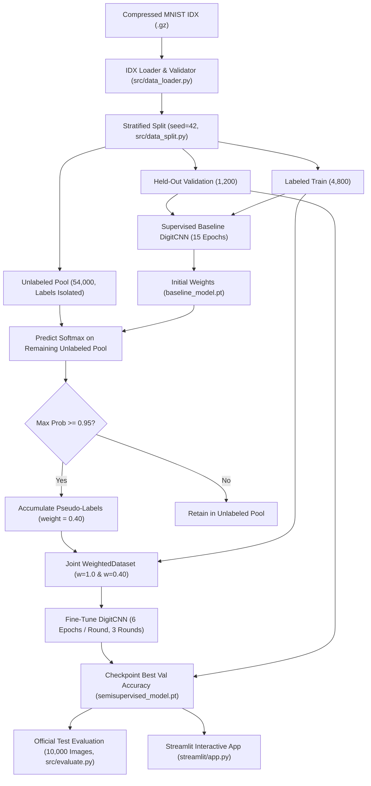
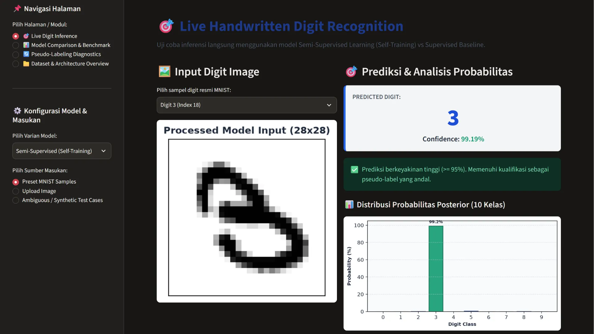
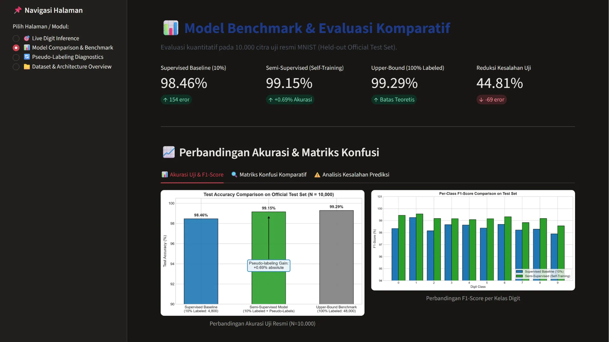
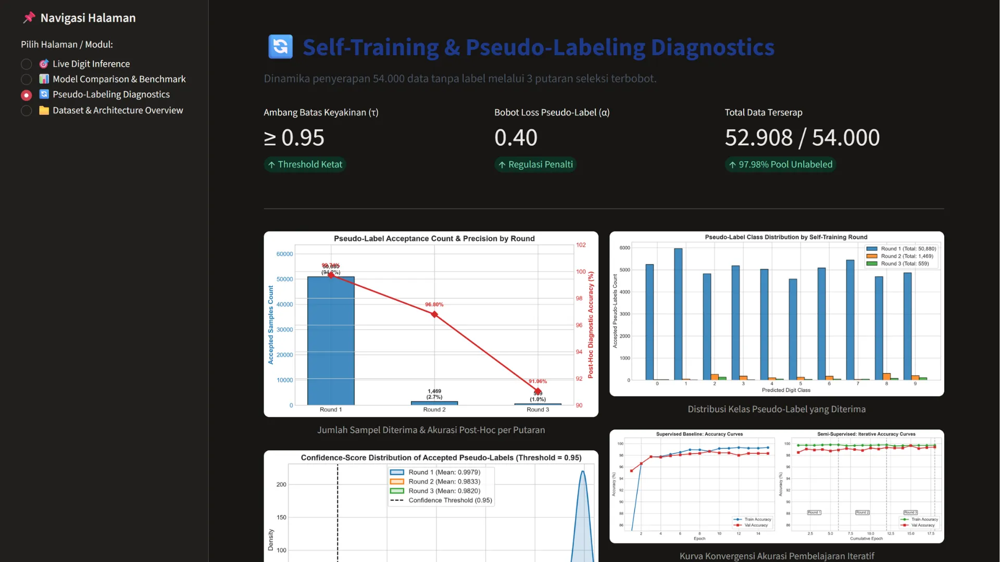
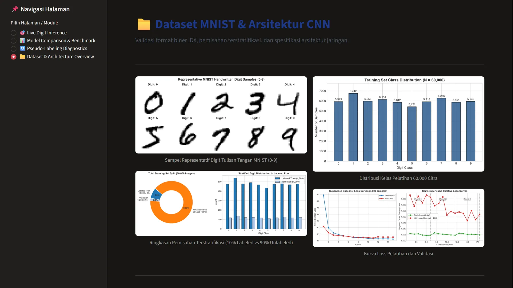
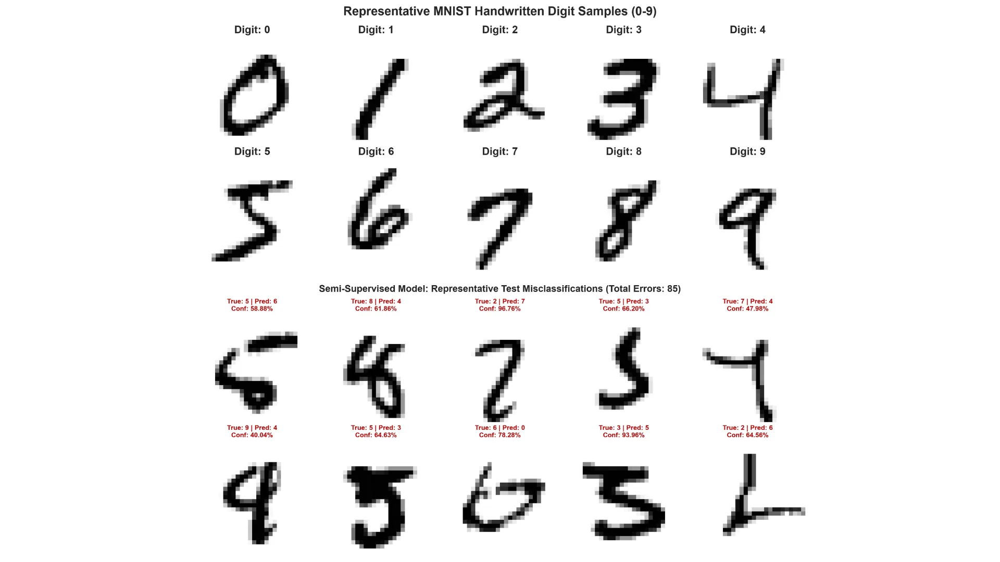
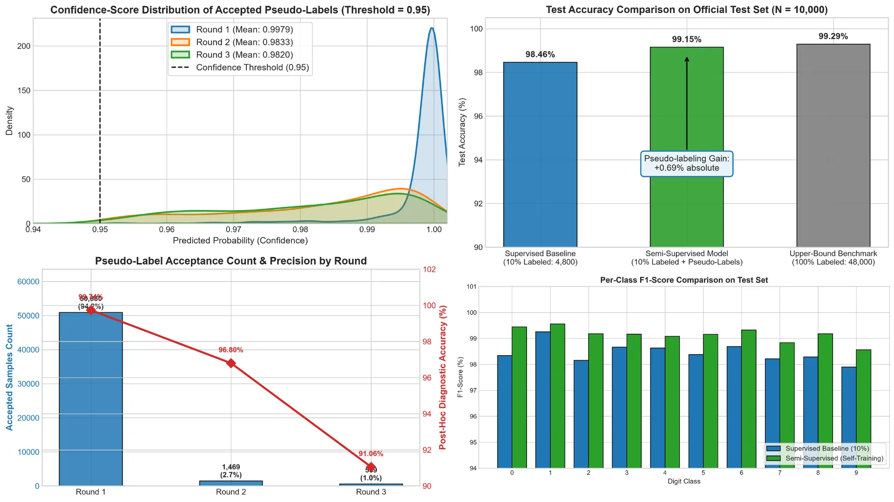
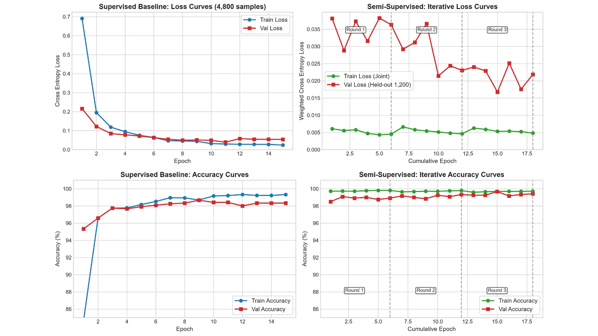
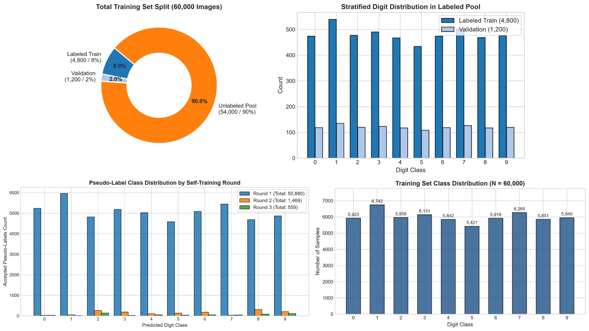
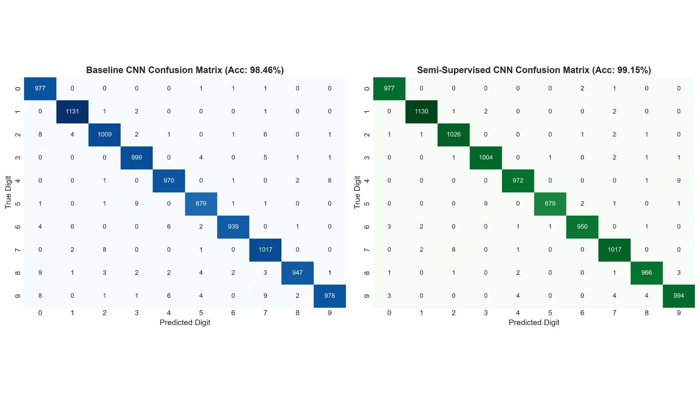

# Handwritten Digit Recognition with Pseudo-Labeling


## Project Overview

Handwritten Digit Recognition with Pseudo-Labeling is a PyTorch semi-supervised image classification project built on the MNIST Handwritten Digits dataset. It evaluates iterative self-training with confidence-based pseudo-labeling under a constrained annotation budget where only 10% of the training set (6,000 images: 4,800 training and 1,200 validation) carries ground-truth labels and the remaining 90% (54,000 images) forms a strictly label-isolated unlabeled pool. Using a 4-layer Convolutional Neural Network (`DigitCNN`), confidence thresholding ($\tau = 0.95$), and weighted pseudo-label loss ($\alpha = 0.40$), the pipeline improves official test accuracy from 98.46% to 99.15% and includes a multi-page Streamlit application for interactive inference and diagnostics.

## Problem Statement & Objectives

Conventional supervised Convolutional Neural Networks rely on tens of thousands of manually annotated images to generalize reliably across handwriting variations. When annotation budgets are limited, training exclusively on a small labeled subset leaves valuable structural information in unlabeled samples unused, while naive self-training risks confirmation bias from propagating incorrect pseudo-labels.

- Partition the 60,000-image MNIST training set using stratified sampling into a 10% labeled pool (4,800 training, 1,200 held-out validation) and a 90% unlabeled pool (54,000 images) with strict ground-truth isolation during training and checkpoint selection.
- Train a supervised baseline `DigitCNN` on the 4,800 labeled samples and an upper-bound reference `DigitCNN` on 48,000 labeled samples (12,000 validation) using an identical architecture for fair comparison.
- Implement iterative self-training across 3 rounds with a softmax confidence threshold of $\tau = 0.95$ and a pseudo-label loss penalty weight of $\alpha = 0.40$ to absorb reliable unlabeled samples while mitigating confirmation bias.
- Evaluate all trained models once on the official 10,000-image MNIST test set using accuracy, macro/per-class precision, recall, F1-score, confusion matrices, error analysis, and out-of-distribution (OOD) diagnostic checks.
- Provide an interactive multi-page Streamlit dashboard (`streamlit/app.py`) for live digit inference, benchmark inspection, and pseudo-labeling diagnostics.

## Data & Input Sources

The project uses the official MNIST Handwritten Digits dataset stored locally in compressed binary IDX format (`.gz`) inside `dataset/original/`. Images are parsed directly from binary headers and payloads via `src/data_loader.py` (magic numbers `2051` for 3D IDX3 images and `2049` for 1D IDX1 labels) without external CSV wrappers or runtime downloads. For interactive inference in `streamlit/app.py`, users can also select preset test digits, upload custom `.png`/`.jpg`/`.jpeg` images, or test synthetic edge-case inputs.

| Attribute | Details |
|---|---|
| Dataset / Input Source | MNIST Handwritten Digits (Compressed Binary IDX) & User Uploaded Images |
| Source | Local IDX archives (`dataset/original/train-images-idx3-ubyte.gz`, `train-labels-idx1-ubyte.gz`, `t10k-images-idx3-ubyte.gz`, `t10k-labels-idx1-ubyte.gz`) |
| Format | Compressed IDX3 (`uint8` images) and IDX1 (`uint8` labels); PNG/JPG for Streamlit uploads |
| Samples / Records | 60,000 training images (4,800 labeled train, 1,200 validation, 54,000 unlabeled pool) and 10,000 official test images |
| Features / Input Shape | `(N, 28, 28)` raw `uint8` grayscale intensity `[0, 255]`, reshaped to `(N, 1, 28, 28)` `float32` tensors `[0.0, 1.0]` |
| Target / Label | 10-class integer digit labels (`0` through `9`) |

## Data Preprocessing & Feature Engineering

Input preparation is implemented consistently across training, evaluation, and interactive inference to preserve pixel scale parity and prevent data leakage between labeled, validation, and unlabeled splits.

| Transformation | Input | Output | Purpose |
|---|---|---|---|
| Binary IDX Decoding | `.gz` IDX1 / IDX3 streams | `(N, 28, 28)` and `(N,)` `uint8` arrays | Validates magic numbers, dimensions, and label range `[0, 9]` |
| Pixel Normalization & Reshaping | `uint8` `(N, 28, 28)` `[0, 255]` | `float32` `(N, 1, 28, 28)` `[0.0, 1.0]` | Scales intensities linearly by `255.0` for PyTorch `Conv2d` layers |
| Stratified Pool Splitting | 60,000 training samples | 4,800 train, 1,200 val, 54,000 unlabeled | Maintains balanced class proportions with `random_seed=42` |
| Upload Image Normalization | Uploaded RGB/RGBA image | `(28, 28)` `uint8` array | Converts to grayscale, resizes via Lanczos, and inverts bright backgrounds |

1. Validate binary IDX integrity, array shapes, `uint8` data types, pixel bounds `[0, 255]`, and label completeness `{0..9}` in `src/data_loader.py`.
2. Split the 60,000 training images via `StratifiedShuffleSplit` (`seed=42`) into 10% labeled pool (6,000 images) and 90% unlabeled pool (54,000 images), then split the 6,000 labeled pool 80%/20% into 4,800 labeled training and 1,200 held-out validation samples (`src/data_split.py`).
3. Isolate `y_unlabeled_hidden` strictly from training, early stopping, thresholding, and checkpoint selection, reserving it solely for post-hoc diagnostic logging.
4. Normalize pixel values by `1 / 255.0` and add a singleton channel dimension (`unsqueeze(1)`) before building PyTorch `TensorDataset` and `WeightedDataset` loaders.

## Tech Stack

| Category | Technology | Purpose |
|---|---|---|
| Language | Python | Core scripting, data parsing, training, evaluation, and UI execution |
| Deep Learning | PyTorch | `DigitCNN` architecture, weighted cross-entropy training, and model checkpoints |
| Vision Utilities | Torchvision | Installed project vision ecosystem dependency listed in `requirements.txt` |
| Numerical Computing | NumPy | IDX binary buffer parsing, array reshaping, and confidence filtering |
| ML Splitting & Metrics | Scikit-learn | `StratifiedShuffleSplit`, accuracy, precision/recall/F1, and confusion matrices |
| Visualization | Matplotlib | Training curves, bar charts, confidence plots, error grids, and UI plots |
| Statistical Plotting | Seaborn | Publication-quality plot styling and confusion matrix heatmaps |
| Image Processing | Pillow | Grayscale conversion, Lanczos resizing, and inversion for uploaded images |
| Interactive UI | Streamlit | Multi-page web dashboard for live digit inference and diagnostics |

## Machine Learning Approach

This project applies **Semi-Supervised Learning** through **Iterative Self-Training with Confidence-Based Pseudo-Labeling** for 10-class optical digit classification. Rather than relying solely on a small labeled subset or modifying the network architecture, the approach expands the effective training set by selectively absorbing high-confidence predictions from the unlabeled pool while down-weighting pseudo-labeled gradients to suppress confirmation bias.

| Attribute | Implementation |
|---|---|
| Learning Paradigm | Semi-Supervised Learning |
| Problem Domain | Computer Vision / Handwritten Digit Recognition |
| ML Task | Multi-Class Image Classification (10 Classes: `0`–`9`) |
| Model Input | Normalized grayscale tensor `(B, 1, 28, 28)` |
| Target / Output | 10-class logits and softmax posterior probabilities |
| Core SSL Mechanism | Confidence thresholding ($\tau = 0.95$) + sample-weighted cross-entropy ($\alpha = 0.40$) |

## Model Overview

All experiments—Supervised Baseline, Semi-Supervised Self-Training, and Upper-Bound Reference—share the identical `DigitCNN` architecture defined in `src/model.py` (468,458 trainable parameters). Every model is trained from scratch on MNIST splits in this repository; no external pretrained weights are loaded.

| Attribute | Specification |
|---|---|
| Model Name | `DigitCNN` |
| Architecture | 2 Convolutional Blocks (Conv2d + BatchNorm2d + ReLU × 2, MaxPool2d, Dropout `0.25`) + Dense Head (`Linear(3136, 128)` + BatchNorm1d + ReLU + Dropout `0.40` + `Linear(128, 10)`) |
| Trainable Parameters | 468,458 |
| Framework | PyTorch (`torch.nn.Module`) |
| Input Tensor | `(B, 1, 28, 28)` `float32` normalized to `[0.0, 1.0]` |
| Output | `(B, 10)` raw logits; `predict_proba` applies `softmax(dim=1)` |
| Pretrained Status | Trained from scratch on project MNIST splits |

## ML Workflow

The repository implements an end-to-end experimental workflow documented in [final_report.md](final_report.md) and organized across modular scripts in `src/` and `streamlit/app.py`:

1. **Binary IDX Ingestion & Validation** ([src/data_loader.py](src/data_loader.py)): Reads compressed `.gz` IDX images and labels, validates magic numbers (`2051`, `2049`), shapes, data types, and class counts.
2. **Stratified Semi-Supervised Splitting** ([src/data_split.py](src/data_split.py)): Partitions 60,000 training images into 4,800 labeled training, 1,200 held-out validation, and 54,000 label-isolated unlabeled samples.
3. **Supervised Baseline & Upper-Bound Training** ([src/train_supervised.py](src/train_supervised.py)): Trains the 10% labeled baseline `DigitCNN` (4,800 train / 1,200 val) and the 100% labeled upper-bound reference (48,000 train / 12,000 val) for 15 epochs each.
4. **Iterative Self-Training with Pseudo-Labeling** ([src/self_training.py](src/self_training.py)): Initializes from `baseline_model.pt` and runs 3 rounds of unlabeled inference, $\tau \ge 0.95$ filtering, and joint weighted fine-tuning ($\alpha = 0.40$) for 6 epochs per round.
5. **Official Test Set Evaluation** ([src/evaluate.py](src/evaluate.py)): Evaluates `baseline_model.pt`, `semisupervised_model.pt`, and `upper_bound_model.pt` on the 10,000-image MNIST test set and exports metrics to JSON.
6. **Optional Label-Budget Sensitivity Study** ([src/label_budget_experiment.py](src/label_budget_experiment.py)): Compares supervised baseline vs. self-training across 1%, 5%, 10%, and 20% labeled budgets.
7. **Publication Visualization & Inference Verification** ([src/visualize.py](src/visualize.py), [src/test_inference.py](src/test_inference.py)): Generates 12 diagnostic figures and verifies inference on digits `0`–`9`, blank inputs, random noise, and hybrid digits.
8. **Interactive Multi-Page Dashboard** ([streamlit/app.py](streamlit/app.py)): Serves live digit prediction, model benchmark comparisons, pseudo-labeling diagnostics, and dataset overview pages.

## ML Pipeline Architecture

The pipeline connects binary IDX ingestion, stratified label isolation, supervised baseline initialization, iterative confidence-filtered self-training, held-out validation checkpointing, single-pass official test evaluation, and interactive Streamlit inference.



## Model Training & Configuration

Supervised training (`src/train_supervised.py`) trains `DigitCNN` from random initialization for 15 epochs using `CrossEntropyLoss`, while iterative self-training (`src/self_training.py`) initializes from the trained supervised baseline weights (`baseline_model.pt`) and executes 3 rounds of 6 epochs each using per-sample weighted `CrossEntropyLoss(reduction="none")` with genuine sample weight `1.0` and pseudo-label weight `0.40`. At the end of each round, weights are retained only if held-out validation accuracy improves over the previous best checkpoint; otherwise, the model reverts to the best checkpoint.

| Parameter | Supervised Baseline | Upper-Bound Reference | Semi-Supervised Self-Training |
|---|---|---|---|
| Labeled Training Samples | 4,800 (10% pool) | 48,000 (100% split) | 4,800 genuine + up to 52,908 pseudo-labeled |
| Validation Samples | 1,200 | 12,000 | 1,200 (identical held-out set) |
| Epochs | 15 | 15 | 3 rounds × 6 epochs (18 cumulative) |
| Batch Size | 64 | 128 | 128 (256 for unlabeled inference) |
| Optimizer | Adam (`lr=1e-3`, `weight_decay=1e-4`) | Adam (`lr=1e-3`, `weight_decay=1e-4`) | Adam (`lr=5e-4`, `weight_decay=1e-4`) |
| Loss Function | `CrossEntropyLoss` | `CrossEntropyLoss` | Weighted `CrossEntropyLoss` (`w_l=1.0`, `w_u=0.40`) |
| Confidence Threshold ($\tau$) | Not applicable | Not applicable | `0.95` |
| Random Seed | `42` | `42` | `42` |
| Checkpoint Criterion | Highest validation accuracy | Highest validation accuracy | Highest validation accuracy |

```python
# Weighted semi-supervised loss formulation in src/self_training.py
unweighted_loss = criterion(logits, y)  # nn.CrossEntropyLoss(reduction="none")
loss = (unweighted_loss * w).mean()     # w = 1.0 for labeled, 0.4 for pseudo-labeled
```

## Model Comparison & Selection

All three model variants share the identical 468,458-parameter `DigitCNN` architecture and are compared on the official 10,000-image MNIST test set (`metrics/evaluation_metrics.json`). The semi-supervised self-training model is selected as the primary model for inference because it closes most of the accuracy gap to the 100%-labeled upper bound while requiring only 10% ground-truth annotations.

| Model Variant | Labeled Data Used | Pseudo-Labeled Data | Best Val Accuracy | Official Test Accuracy | Macro F1-Score | Test Errors (of 10,000) |
|---|---:|---:|---:|---:|---:|---:|
| Supervised Baseline | 4,800 (10% pool) | 0 | 98.67% | 98.46% | 98.45% | 154 |
| Semi-Supervised (Self-Training) | 4,800 (10% pool) | 52,908 (97.98% pool) | 99.67% | 99.15% | 99.15% | 85 |
| Upper-Bound Reference | 48,000 (100% split) | 0 | 99.39% | 99.29% | 99.29% | 71 |

## Model Artifacts & Checkpoints

All serialized PyTorch model weights (`state_dict` checkpoints) and experimental metric logs generated during training and evaluation are stored in the repository under `models/` and `metrics/`.

| Artifact | Format | Purpose | Repository Location |
|---|---|---|---|
| `baseline_model.pt` | PyTorch `.pt` | Best validation checkpoint for 10% labeled supervised baseline | `models/baseline_model.pt` |
| `semisupervised_model.pt` | PyTorch `.pt` | Best validation checkpoint after 3 self-training rounds | `models/semisupervised_model.pt` |
| `upper_bound_model.pt` | PyTorch `.pt` | Best validation checkpoint for 100% labeled upper-bound reference | `models/upper_bound_model.pt` |
| `baseline_history.json` | JSON | Per-epoch training/validation loss and accuracy for baseline | `metrics/baseline_history.json` |
| `self_training_history.json` | JSON | Round-by-round acceptance counts, post-hoc accuracy, and 18-epoch curves | `metrics/self_training_history.json` |
| `upper_bound_history.json` | JSON | Per-epoch training/validation curves for upper-bound reference | `metrics/upper_bound_history.json` |
| `evaluation_metrics.json` | JSON | Official test set metrics, confusion matrices, and up to 100 error samples | `metrics/evaluation_metrics.json` |

## Model Evaluation & Results

On the official 10,000-image MNIST test set (`metrics/evaluation_metrics.json`), iterative self-training improved test accuracy by **+0.69 percentage points** (+0.70% relative gain) over the supervised baseline and reduced total misclassifications by **44.81%** (from 154 errors down to 85 errors), coming within 0.14 percentage points of the 100%-labeled upper-bound benchmark (99.29%).

| Metric (Official Test Set, N = 10,000) | Supervised Baseline (10%) | Semi-Supervised Self-Training | Upper-Bound Reference (100%) |
|---|---:|---:|---:|
| Test Accuracy | 98.46% | 99.15% | 99.29% |
| Macro Precision | 98.47% | 99.16% | 99.30% |
| Macro Recall | 98.44% | 99.14% | 99.28% |
| Macro F1-Score | 98.45% | 99.15% | 99.29% |
| Total Misclassifications | 154 | 85 | 71 |

Post-hoc diagnostic evaluation against the strictly isolated hidden ground-truth labels (`metrics/self_training_history.json`) and edge-case testing (`src/test_inference.py`) highlight key behavioral dynamics:

- **Round 1 Absorption:** Accepted 50,880 of 54,000 unlabeled images (94.22% of pool) with 99.74% post-hoc accuracy (50,746 / 50,880) and 0.9979 mean confidence, raising held-out validation accuracy from 98.33% to 99.08%.
- **Round 2 Absorption:** Accepted 1,469 of the remaining 3,120 images (2.72% of initial pool) with 96.80% post-hoc accuracy (1,422 / 1,469) and 0.9833 mean confidence, improving validation accuracy to 99.33%.
- **Round 3 Absorption:** Accepted 559 of the remaining 1,651 images (1.04% of initial pool) with 91.06% post-hoc accuracy (509 / 559) and 0.9820 mean confidence, reaching 99.67% validation accuracy while leaving 1,092 ambiguous images unabsorbed (cumulative 52,908 accepted, 97.98% of pool, 99.58% weighted post-hoc accuracy).
- **Per-Class Gains & Residual Errors:** F1-score improved across all 10 digit classes (largest gains on digit `0` from 98.34% to 99.44% and digit `2` from 98.15% to 99.18%); residual errors occur primarily on visually ambiguous handwritten pairs (e.g., `5` vs. `3`, `4` vs. `9`, `2` vs. `7`).
- **OOD Overconfidence Limitation:** Diagnostic inference tests (`src/test_inference.py`) show that uncalibrated BatchNorm + ReLU layers still produce >97% softmax confidence on blank all-zero or uniform random noise inputs, confirming that confidence thresholding assumes in-distribution unlabeled data.

## Results Visualization & Preview

### 1. Live Handwritten Digit Inference Interface

Interactive inference view in `streamlit/app.py` evaluating a 28×28 MNIST Digit `3` sample with the semi-supervised model. The prediction card reports class `3` at 99.19% softmax confidence—exceeding the $\tau = 0.95$ pseudo-label threshold—while the posterior probability distribution confirms negligible probability mass on competing classes.

### 2. Model Benchmark & Evaluation Metrics Dashboard

Benchmark dashboard view summarizing held-out official test set performance across all three variants (98.46% baseline, 99.15% semi-supervised, and 99.29% upper bound) alongside the 44.81% test error reduction. The embedded bar charts confirm both the +0.69% absolute accuracy gain and consistent per-class F1-score improvements across digits `0` through `9`.

### 3. Self-Training & Pseudo-Labeling Diagnostics View

Self-training diagnostics module illustrating the $\tau \ge 0.95$ confidence threshold, $\alpha = 0.40$ loss penalty, and cumulative absorption of 52,908 out of 54,000 unlabeled images (97.98%). The four embedded plots track round-by-round sample acceptance versus post-hoc precision, balanced class counts across rounds, confidence density peaking near `1.0`, and iterative training/validation accuracy curves.

### 4. Dataset MNIST & CNN Architecture Overview

Dataset overview panel presenting representative MNIST digits `0`–`9`, the balanced 60,000-sample training class distribution (`5,421` to `6,742` samples per digit), and the stratified 10% labeled versus 90% unlabeled split. Alongside the data views, the loss curves show smooth convergence for both the 15-epoch supervised baseline and the 3-round weighted self-training phase.

### 5. Representative MNIST Samples & Test Misclassification Grid

Qualitative comparison between clean representative MNIST digits (`0`–`9`, top) and representative test misclassifications from the 85 total errors made by the semi-supervised model (bottom). Annotated true labels, predicted labels, and confidence scores show that errors concentrate on degraded strokes and inherently ambiguous handwriting such as `5` predicted as `3` or `9` predicted as `4`.

### 6. Confidence Distribution, Test Accuracy, Round Precision & Per-Class F1 Composite

Four-panel quantitative summary combining pseudo-label confidence density distributions (`0.9979` mean in Round 1, `0.9833` in Round 2, `0.9820` in Round 3) with round acceptance counts and post-hoc precision decay (`99.74%` → `96.80%` → `91.06%`). The right-hand panels contrast the 98.46% baseline, 99.15% semi-supervised, and 99.29% upper-bound test accuracies alongside per-class F1-score gains across every digit.

### 7. Supervised Baseline vs. Semi-Supervised Learning Curves

Loss and accuracy trajectories comparing the 15-epoch supervised baseline (left) against the 18-cumulative-epoch iterative self-training run across Rounds 1–3 (right). While baseline validation loss plateaus around `0.05` and validation accuracy peaks at `98.67%`, iterative joint training lowers held-out validation loss below `0.02` and lifts validation accuracy to `99.67%` in Round 3.

### 8. Stratified Data Split & Class Distribution Composite

Four-panel data distribution audit confirming exact stratification across the 60,000 MNIST training samples (8.0% labeled train, 2.0% validation, 90.0% unlabeled pool) and balanced digit proportions in the 6,000-image labeled pool. The bottom-left bar chart further verifies that accepted pseudo-labels across Rounds 1–3 remain evenly distributed across all ten classes without mode collapse.

### 9. Comparative Confusion Matrices on Official Test Set

Side-by-side 10×10 confusion matrices on the 10,000-image official MNIST test set for the Supervised Baseline CNN (98.46% accuracy, 154 errors) and the Semi-Supervised CNN (99.15% accuracy, 85 errors). Off-diagonal reductions are particularly pronounced for digits `0`, `2`, `6`, `8`, and `9`, demonstrating stronger decision boundaries after absorbing pseudo-labeled data.

## Prerequisites

- **Operating System:** Windows, Linux, or macOS.
- **Python Runtime:** Python 3.9 or higher (as documented in [final_report.md](final_report.md)).
- **Core Libraries (`requirements.txt`):** `torch`, `torchvision`, `numpy`, `scikit-learn`, `matplotlib`, `seaborn`, `pillow`, and `streamlit`.
- **Compute Hardware:** Standard CPU execution is fully supported for both training and Streamlit inference (`streamlit/app.py` runs inference on CPU); an NVIDIA CUDA GPU is optional and automatically utilized by `src/` training/evaluation scripts when available.
- **Dataset Files:** Compressed MNIST IDX `.gz` archives present in `dataset/original/`.

## Installation & Setup

1. Clone the repository and navigate into the project directory:
   ```bash
   git clone https://github.com/weztcy/Handwritten-Digit-Recognition-with-Pseudo-Labeling.git
   cd "Handwritten Digit Recognition with Pseudo-Labeling"
   ```
2. Create and activate a virtual environment:
   ```bash
   python -m venv .venv
   # Windows PowerShell
   .\.venv\Scripts\Activate.ps1
   # Linux / macOS
   source .venv/bin/activate
   ```
3. Install all required Python dependencies:
   ```bash
   pip install -r requirements.txt
   ```

## Usage & Execution

Once the environment is configured, you can launch the interactive Streamlit dashboard using the precomputed checkpoints and figures or run individual verification scripts from the repository root.

1. **Launch the Interactive Streamlit Application:**
   Note that `streamlit/app.py` expects `outputs/models/`, `outputs/figures/`, and `dataset/*.gz` relative to the working directory when running live pages that read those paths, whereas the repository stores them in `models/`, `figures/`, and `dataset/original/`. Ensure those paths are linked or aligned in your working directory before starting:
   ```bash
   streamlit run streamlit/app.py
   ```
2. **Run Diagnostic Inference Verification:**
   ```bash
   python src/test_inference.py
   ```
3. **Inspect `DigitCNN` Tensor Shapes & Parameter Count:**
   ```bash
   python src/model.py
   ```

## Reproducibility & Execution

All experiments use a fixed random seed (`42`) across Python's `random`, `numpy`, `torch`, `torch.cuda`, and `StratifiedShuffleSplit` to reproduce the exact 4,800 / 1,200 / 54,000 splits and training configuration. Note that the scripts in `src/` read MNIST archives from `dataset/` and write outputs to `outputs/models/`, `outputs/metrics/`, and `outputs/figures/`, while the committed repository organizes those assets directly under `dataset/original/`, `models/`, `metrics/`, and `figures/`.

1. Align the local working paths if re-running the training pipeline from scratch (for example, copying `dataset/original/*.gz` into `dataset/` so `src/data_loader.py` locates the IDX archives).
2. Validate the MNIST IDX archives and stratified splits:
   ```bash
   python src/data_loader.py
   python src/data_split.py
   ```
3. Train the Supervised Baseline (10% labeled) and Upper-Bound Reference (100% labeled) models:
   ```bash
   python src/train_supervised.py
   ```
4. Execute the 3-round Iterative Self-Training pipeline ($\tau = 0.95$, $\alpha = 0.40$):
   ```bash
   python src/self_training.py
   ```
5. Evaluate all checkpoints on the 10,000-image official MNIST test set and regenerate the 12 figures:
   ```bash
   python src/evaluate.py
   python src/visualize.py
   ```
6. *(Optional)* Run the multi-budget sensitivity comparison across 1%, 5%, 10%, and 20% labeled budgets:
   ```bash
   python src/label_budget_experiment.py
   ```

Note that minor floating-point variations may still occur across different hardware backends (CPU vs. CUDA cuDNN kernels) when retraining from scratch.

## Contributing

Contributions to improve calibration, OOD filtering, or semi-supervised training strategies are welcome. Please follow this standard workflow:

1. Fork the repository.
2. Create a branch for the change.
3. Make the changes.
4. Run relevant checks or tests when available (e.g., `python src/model.py`, `python src/test_inference.py`).
5. Commit and push the branch.
6. Open a pull request with a clear explanation.

## License

This project is licensed under the MIT License.
See the [LICENSE](LICENSE) file for details.

## Author & Contact

**Yohanes Dimas Pratama**

- GitHub: [github.com/weztcy](https://github.com/weztcy)
- Portfolio: [yohanesdimas.com](https://yohanesdimas.com)
- LinkedIn: [linkedin.com/in/yohanes-dimas](https://www.linkedin.com/in/yohanes-dimas)
