# Handwritten Digit Recognition with Pseudo-Labeling

**Learning Paradigm:** Semi-Supervised Learning  
**Primary Method:** Iterative Self-Training with Confidence-Based Pseudo-Labeling  
**Dataset:** MNIST Handwritten Digits (Compressed IDX Format)  
**Evaluasi Akhir:** Official Held-Out Test Set (10.000 Citra)  

---

## 1. Judul Project

**Handwritten Digit Recognition with Pseudo-Labeling**

---

## 2. Ringkasan Eksekutif

Dalam skenario dunia nyata, proses pengumpulan data mentah sering kali sangat mudah dan murah, namun proses pelabelan (*ground-truth annotation*) oleh pakar manusia membutuhkan biaya, waktu, dan tenaga yang sangat besar. Proyek ini mengimplementasikan paradigma **Semi-Supervised Learning (SSL)** menggunakan metode **Self-Training dengan Confidence-Based Pseudo-Labeling** pada tugas klasifikasi digit tulisan tangan MNIST (10 kelas, digit `0` hingga `9`). 

Skenario eksperimen utama dirancang secara ketat dengan mensimulasikan ketersediaan data berlabel yang terbatas: hanya **10% dari data latih resmi (6.000 citra)** yang dialokasikan ke dalam *labeled pool*, sementara **90% sisanya (54.000 citra)** diperlakukan sebagai *unlabeled pool* yang label aslinya disembunyikan (*hidden ground-truth*) dan diisolasi sepenuhnya dari fase pelatihan, penyesuaian ambang batas, maupun pemilihan model. Dari 6.000 data pada *labeled pool*, dilakukan pembagian terstratifikasi menjadi **4.800 citra latih berlabel** dan **1.200 citra validasi held-out**.

Hasil eksperimen empiris menunjukkan bahwa:
1. **Supervised Baseline CNN** yang dilatih hanya menggunakan 4.800 sampel berlabel menghasilkan akurasi uji resmi sebesar **98,46%** (*Macro F1-Score* 98,45%, dengan 154 kesalahan klasifikasi dari 10.000 citra uji).
2. **Semi-Supervised Self-Training Model** melalui 3 putaran (*rounds*) seleksi dengan ambang batas keyakinan $\tau = 0,95$ dan pembobotan loss penalti $\alpha = 0,40$ berhasil mengintegrasikan **52.908 citra tanpa label (97,98% dari total *unlabeled pool*)**. Model semi-terawasi akhir mencapai akurasi uji sebesar **99,15%** (*Macro F1-Score* 99,15%, dengan 85 kesalahan klasifikasi).
3. Pemanfaatan data tak berlabel menghasilkan peningkatan akurasi absolut sebesar **+0,69%**, peningkatan relatif sebesar **+0,70%**, dan memangkas jumlah kesalahan klasifikasi pada data uji sebesar **44,81%** (dari 154 eror menjadi 85 eror).
4. Sebagai tolok ukur batas atas (*upper-bound benchmark*), model CNN identik yang dilatih menggunakan seluruh 100% data berlabel (48.000 latih + 12.000 validasi) mencatat akurasi uji sebesar **99,29%** (71 kesalahan). Hal ini membuktikan bahwa pipeline *pseudo-labeling* dengan hanya 10% label mampu mendekati performa model supervisi penuh (selisih hanya 0,14%) tanpa memerlukan biaya pelabelan untuk 54.000 citra lainnya.

---

## 3. Latar Belakang

Pengenalan digit tulisan tangan (*Handwritten Digit Recognition*) merupakan salah satu fondasi fundamental dalam visi komputer dan pengenalan pola. Aplikasi praktisnya mencakup pembacaan kode pos pada pemrosesan surat pos otomatis, digitalisasi formulir pajak dan sensus, hingga pemindaian nominal cek perbankan.

Secara konvensional, model pembelajaran mendalam (*Deep Learning*) berbasis Convolutional Neural Network (CNN) membutuhkan puluhan ribu sampel berlabel untuk mencapai generalisasi yang andal. Namun, dalam banyak aplikasi industri, anotasi manual berskala besar tidak praktis dan memakan biaya tinggi. Semi-Supervised Learning (SSL) hadir sebagai jembatan yang menghubungkan keterbatasan label dengan kelimpahan data tanpa label.

Metode *Self-Training* bekerja dengan cara melatih model awal pada data berlabel yang sedikit, memprediksi probabilitas kelas untuk data tanpa label, menyaring prediksi dengan keyakinan tinggi (*high-confidence predictions*) sebagai label semu (*pseudo-labels*), dan melatih ulang model pada gabungan data asli dan data semu. Kendala utama pada metode ini adalah risiko **confirmation bias**, di mana prediksi yang salah namun percaya diri dimasukkan ke dalam data latih, menyebabkan eror terakumulasi dan merusak konvergensi model. Oleh karena itu, penerapan ambang batas keyakinan (*confidence thresholding*) dan pembobotan penalti loss (*loss weighting*) menjadi komponen krusial untuk menjamin stabilitas dan akurasi model semi-terawasi.

---

## 4. Deskripsi Dataset

Dataset yang digunakan adalah benchmark resmi MNIST Handwritten Digits yang disediakan dalam format biner terkompresi IDX (`.gz`). 

### 4.1 Inventaris File Dataset

| Nama File | Peruntukan | Format | Ukuran Terkompresi | Jumlah Sampel |
|---|---|---|---:|---:|
| `train-images-idx3-ubyte.gz` | Citra Pelatihan | IDX3 (3D uint8) | 9.912.422 bytes | 60.000 |
| `train-labels-idx1-ubyte.gz` | Label Pelatihan | IDX1 (1D uint8) | 28.881 bytes | 60.000 |
| `t10k-images-idx3-ubyte.gz` | Citra Evaluasi Uji | IDX3 (3D uint8) | 1.648.877 bytes | 10.000 |
| `t10k-labels-idx1-ubyte.gz` | Label Evaluasi Uji | IDX1 (1D uint8) | 4.542 bytes | 10.000 |

### 4.2 Validasi Karakteristik Data secara Programatik

Data dimuat secara langsung melalui modul `src/data_loader.py` dengan mengurai *header* dan *payload* IDX biner secara tepat tanpa menggunakan pustaka pihak ketiga pembungkus CSV atau pengunduhan ulang. Hasil validasi programatik mencatat:
- Dimensi Citra Latih: `(60000, 28, 28)`, tipe data `uint8`.
- Dimensi Label Latih: `(60000,)`, nilai integer dalam rentang `[0, 9]`.
- Dimensi Citra Uji: `(10000, 28, 28)`, tipe data `uint8`.
- Dimensi Label Uji: `(10000,)`, nilai integer dalam rentang `[0, 9]`.
- Rentang Piksel Asli: Minimum `0`, Maksimum `255`.
- *Magic Numbers*: `2051` untuk file citra IDX3, dan `2049` untuk file label IDX1.

### 4.3 Sampel Visual MNIST dan Distribusi Kelas

Berikut adalah visualisasi sampel representatif dari digit 0 hingga 9 pada dataset MNIST:

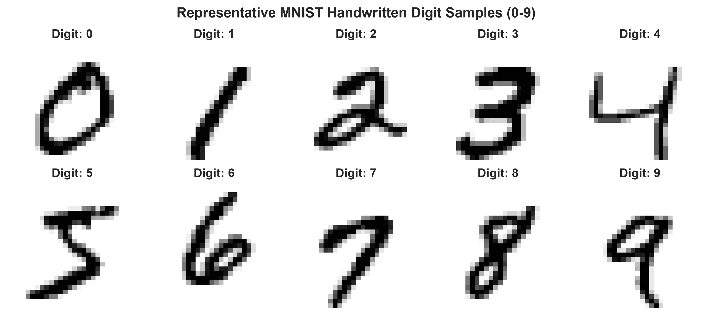

Distribusi kelas pada 60.000 citra pelatihan terdistribusi secara seimbang antar kelas:

| Digit | Jumlah Sampel | Persentase | Digit | Jumlah Sampel | Persentase |
|:---:|:---:|:---:|:---:|:---:|:---:|
| **0** | 5.923 | 9,87% | **5** | 5.421 | 9,04% |
| **1** | 6.742 | 11,24% | **6** | 5.918 | 9,86% |
| **2** | 5.958 | 9,93% | **7** | 6.265 | 10,44% |
| **3** | 6.131 | 10,22% | **8** | 5.851 | 9,75% |
| **4** | 5.842 | 9,74% | **9** | 5.949 | 9,92% |
| **Total** | **60.000** | **100,00%** | | | |

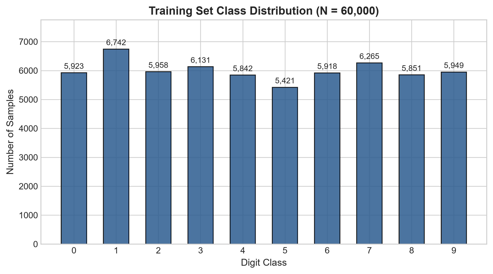

---

## 5. Perumusan Masalah dan Tujuan

### 5.1 Perumusan Masalah
1. Bagaimana merancang arsitektur model klasifikasi citra yang mampu beroperasi secara efektif ketika hanya sebagian kecil data (10%) yang memiliki label kebenaran (*ground-truth*)?
2. Bagaimana mekanisme penyaringan ambang batas keyakinan (*confidence thresholding*) dan pembobotan loss (*pseudo-loss weighting*) dapat mencegah akumulasi kesalahan (*confirmation bias*) selama iterasi *self-training*?
3. Seberapa besar kontribusi penambahan data tanpa label (*unlabeled pool*) dalam meningkatkan akurasi, metrik F1-Score, dan reduksi kesalahan uji dibandingkan model *supervised baseline*?

### 5.2 Tujuan Eksperimen
1. Membangun pipeline pemisahan data terstratifikasi yang memisahkan 10% *labeled pool* (4.800 latih + 1.200 validasi) dan 90% *unlabeled pool* (54.000 sampel) dengan isolasi label yang mutlak.
2. Melatih model *Supervised Baseline CNN* menggunakan hanya 4.800 sampel berlabel sebagai garis pangkal performa.
3. Mengembangkan algoritma *Iterative Self-Training with Pseudo-Labeling* berbasis ambang batas keyakinan $\tau = 0,95$ dan bobot loss $\alpha = 0,40$.
4. Mengevaluasi seluruh model pada 10.000 citra uji resmi dan menganalisis dinamika penerimaan pseudo-label, akurasi per kelas, matriks konfusi, dan pola kesalahan uji.
5. Menyediakan aplikasi interaktif berbasis Streamlit beserta dokumentasi tangkapan layar penuh (*full-page screenshot*) yang terverifikasi.

---

## 6. Metodologi

### 6.1 Prapemrosesan Data
- Normalisasi intensitas piksel citra secara linier dari interval bilangan bulat `[0, 255]` ke interval floating-point `[0.0, 1.0]` dengan membagi setiap piksel dengan nilai `255.0`.
- Menambahkan dimensi kanal (*channel dimension*) sehingga tensor input memiliki format PyTorch standar $(N, C, H, W) = (N, 1, 28, 28)$.

### 6.2 Pembagian Dataset dan Protokol Isolasi Label
Pemisahan dilakukan secara terstratifikasi (*stratified shuffle split*) dengan *random seed* tetap `42`:
1. **Total Data Latih (60.000 citra)** dibagi menjadi:
   - **Labeled Pool (10% = 6.000 citra)**
   - **Unlabeled Pool (90% = 54.000 citra)**
2. **Labeled Pool (6.000 citra)** dibagi lebih lanjut menjadi:
   - **Training Labeled (80% = 4.800 citra)**
   - **Held-out Validation Set (20% = 1.200 citra)**
3. **Isolasi Mutlak (*Strict Label Isolation*)**: Label asli milik 54.000 citra tanpa label disembunyikan dalam memori dan dilarang digunakan dalam fase pelatihan, *early stopping*, pemilihan ambang batas, maupun pemilihan *checkpoint* terbaik. Komparasi dengan label asli hanya dilakukan secara *post-hoc diagnostic* setelah model dan eksperimen selesai dibekukan.

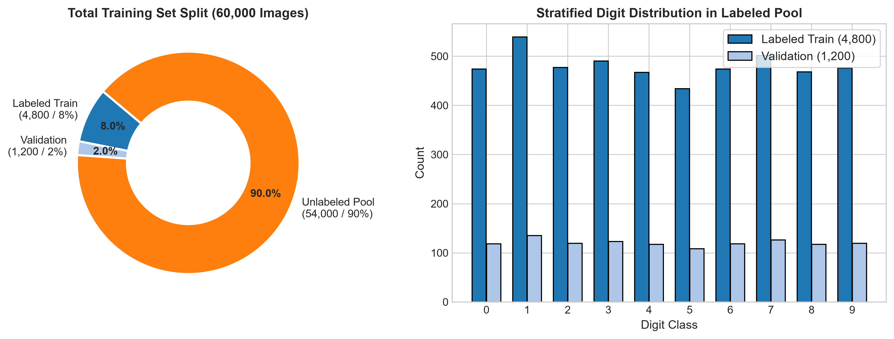

### 6.3 Arsitektur Convolutional Neural Network (DigitCNN)
Untuk memastikan perbandingan yang adil (*apples-to-apples comparison*), arsitektur model yang digunakan pada Supervised Baseline dan Semi-Supervised Model adalah identik:

```text
Input: (B, 1, 28, 28)
│
├── [Blok Konvolusi 1]
│   ├── Conv2d(1 -> 32, kernel_size=3, padding=1) + BatchNorm2d(32) + ReLU
│   ├── Conv2d(32 -> 32, kernel_size=3, padding=1) + BatchNorm2d(32) + ReLU
│   ├── MaxPool2d(kernel_size=2, stride=2)  --> Output: (B, 32, 14, 14)
│   └── Dropout(p=0.25)
│
├── [Blok Konvolusi 2]
│   ├── Conv2d(32 -> 64, kernel_size=3, padding=1) + BatchNorm2d(64) + ReLU
│   ├── Conv2d(64 -> 64, kernel_size=3, padding=1) + BatchNorm2d(64) + ReLU
│   ├── MaxPool2d(kernel_size=2, stride=2)  --> Output: (B, 64, 7, 7)
│   └── Dropout(p=0.25)
│
└── [Klasifikasi Dense]
    ├── Flatten()                           --> Output: (B, 3136)
    ├── Linear(3136 -> 128) + BatchNorm1d(128) + ReLU
    ├── Dropout(p=0.40)
    └── Linear(128 -> 10)                   --> Output Logits: (B, 10)
```
- **Total Parameter Terlatih:** 468.458 parameter.

### 6.4 Formulasi Fungsi Loss Terbobot (*Weighted Loss Formulation*)
Dalam pelatihan semi-terawasi gabungan, setiap mini-batch dapat memuat sampel berlabel asli $(x_i^l, y_i^l)$ dan sampel pseudo-label $(x_j^u, \hat{y}_j^u)$. Fungsi loss dirumuskan sebagai berikut:

$$\mathcal{L}_{\text{total}} = \frac{1}{|B|} \sum_{i \in B} w_i \cdot \ell_{\text{CE}}(f(x_i), y_i)$$

di mana bobot sampel $w_i$ ditentukan secara adaptif:
$$w_i = \begin{cases} 1,0 & \text{jika } x_i \text{ berasal dari data berlabel asli} \\ \alpha & \text{jika } x_i \text{ merupakan pseudo-label diterima } (\alpha = 0,40) \end{cases}$$

Pengurangan bobot $\alpha = 0,40$ berfungsi sebagai mekanisme regulasi penalti: jika terdapat label semu yang salah (*noisy pseudo-label*), gradien eror yang dipropagasi balik hanya menyumbang 40% dari magnitudo gradien data berlabel asli, sehingga stabilitas representasi fitur tetap terjaga.

---

## 7. Desain Eksperimen

| Parameter Eksperimen | Nilai / Konfigurasi | Keterangan & Rasional |
|---|---|---|
| **Random Seed** | `42` | Menjamin reproduktibilitas penuh pada NumPy, PyTorch, dan Sklearn |
| **Alokasi Label** | 10% Labeled (4.800 latih, 1.200 validasi) | Mensimulasikan skenario kelangkaan data anotasi |
| **Alokasi Unlabeled** | 90% (54.000 citra) | Sumber penguatan representasi fitur |
| **Ambang Batas Keyakinan ($\tau$)** | $0,95$ ($\max P(y|x) \ge 0,95$) | Ambang batas konservatif untuk menekan *false pseudo-labels* |
| **Bobot Loss Pseudo-Label ($\alpha$)** | $0,40$ | Penalti penjinak *confirmation bias* |
| **Jumlah Maksimal Round** | 3 rounds | Siklus iterasi *predict-threshold-retrain* |
| **Epoch per Round** | 6 epoch | Fine-tuning terarah pada bobot model |
| **Batch Size** | 128 | Efisiensi paralelisasi mini-batch pada CPU multi-core |
| **Optimizer** | Adam ($\text{lr} = 5 \times 10^{-4}$, weight decay $= 10^{-4}$) | Konvergensi adaptif dengan regularisasi $L_2$ ringan |
| **Kriteria Checkpoint** | Akurasi Validasi Tertinggi | Model terbaik disimpan murni berdasarkan validasi held-out |
| **Kumpulan Data Uji** | 10.000 citra resmi MNIST | Dievaluasi hanya satu kali di akhir eksperimen |

---

## 8. Hasil Eksperimen

### 8.1 Metrik Evaluasi Komparatif pada Test Set Resmi (10.000 Citra)

Tabel berikut menyajikan metrik komparasi kuantitatif antara model *Supervised Baseline*, *Semi-Supervised Learning*, dan *Upper-Bound Reference Benchmark*:

| Model / Pendekatan | Data Latih Berlabel | Data Pseudo-Label | Akurasi Uji | Macro Precision | Macro Recall | Macro F1-Score | Jumlah Eror |
|---|:---:|:---:|:---:|:---:|:---:|:---:|:---:|
| **Supervised Baseline** | 4.800 (10%) | 0 | **98,46%** | 98,47% | 98,44% | **98,45%** | 154 |
| **Semi-Supervised (Self-Training)** | 4.800 (10%) | 52.908 (98%) | **99,15%** | 99,16% | 99,14% | **99,15%** | **85** |
| *Upper-Bound Benchmark* | 48.000 (100%) | 0 | *99,29%* | *99,29%* | *99,29%* | *99,29%* | *71* |

Perubahan performa Semi-Supervised Model terhadap Supervised Baseline:
- **Peningkatan Akurasi Absolut:** $+0,69\%$ ($98,46\% \rightarrow 99,15\%$)
- **Peningkatan Relatif:** $+0,70\%$
- **Reduksi Kesalahan Klasifikasi Uji:** **$44,81\%$** (dari 154 eror turun menjadi 85 eror).

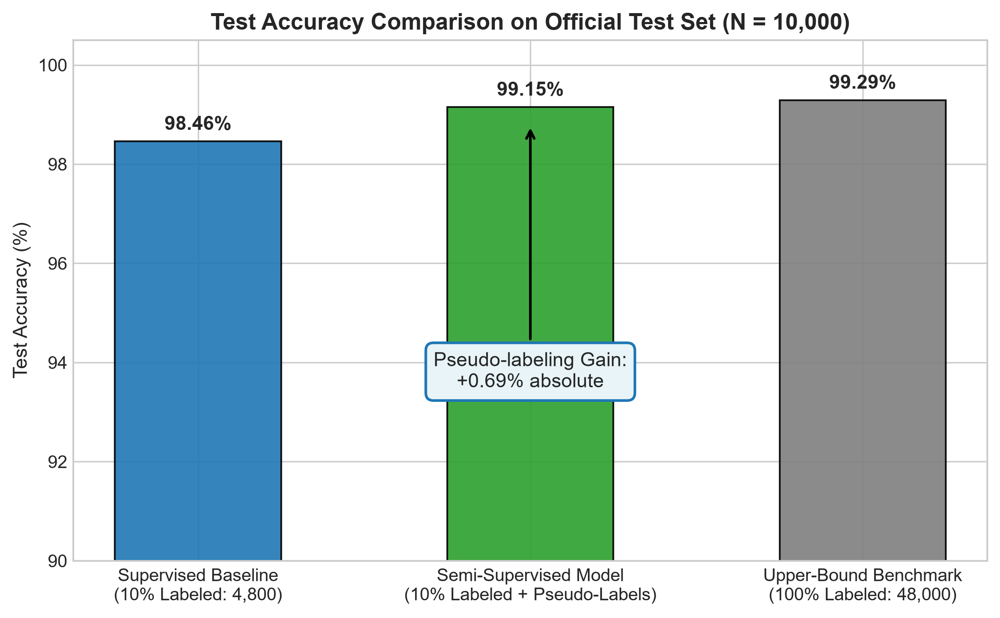

### 8.2 Dinamika Penerimaan Pseudo-Label Antar Round

Iterasi self-training berlangsung selama 3 putaran dengan akumulasi sampel sebagai berikut:

| Round | Kandidat Unlabeled | Diterima ($\tau \ge 0,95$) | % dari Pool Awal | Akurasi Post-Hoc vs Hidden GT | Sisa Unlabeled | Akurasi Validasi |
|:---:|:---:|:---:|:---:|:---:|:---:|:---:|
| **Inisial** | - | - | - | - | 54.000 | 98,33% |
| **Round 1** | 54.000 | 50.880 | 94,22% | **99,74%** (50.746 / 50.880) | 3.120 | 99,08% |
| **Round 2** | 3.120 | 1.469 | 2,72% | **96,80%** (1.422 / 1.469) | 1.651 | 99,33% |
| **Round 3** | 1.651 | 559 | 1,04% | **91,06%** (509 / 559) | **1.092** | **99,67%** |
| **Kumulatif**| - | **52.908** | **97,98%** | **99,58%** rata-rata tertimbang | - | - |

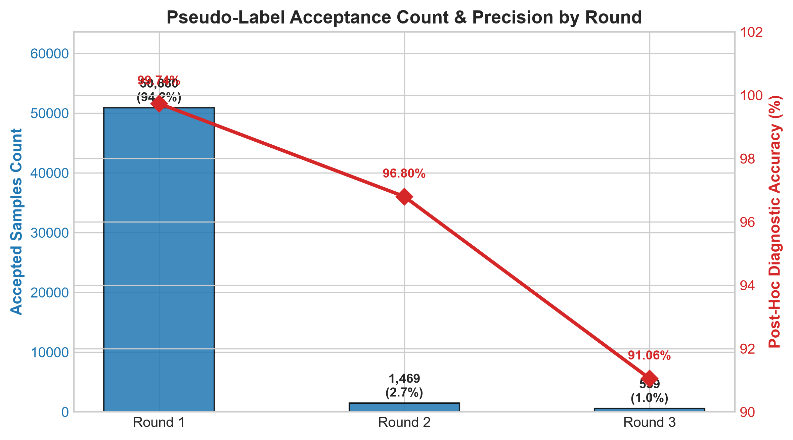

Distribusi kelas dari pseudo-label yang diterima pada setiap putaran terbukti proporsional dan tidak mengalami kolaps modus (*mode collapse*):

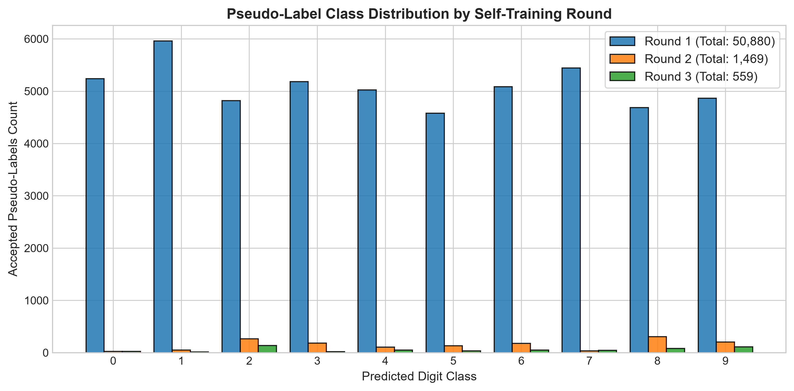

Kurva distribusi skor keyakinan (*confidence-score distribution*) menunjukkan bahwa mayoritas prediksi pada sampel yang diterima berkumpul sangat dekat dengan nilai 1.0:

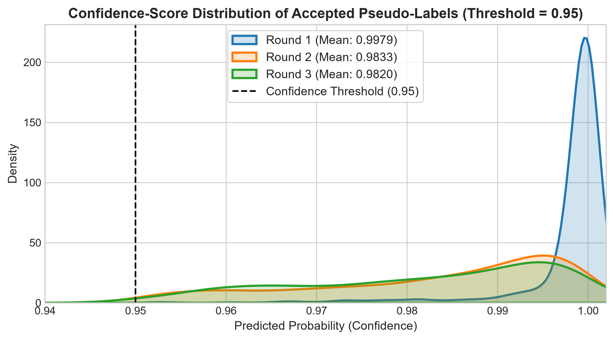

### 8.3 Kurva Pembelajaran (Loss & Akurasi)

Kurva pembelajaran di bawah ini mendokumentasikan konvergensi loss dan akurasi pada Supervised Baseline serta dinamika pelatihan multi-round pada Semi-Supervised Model:

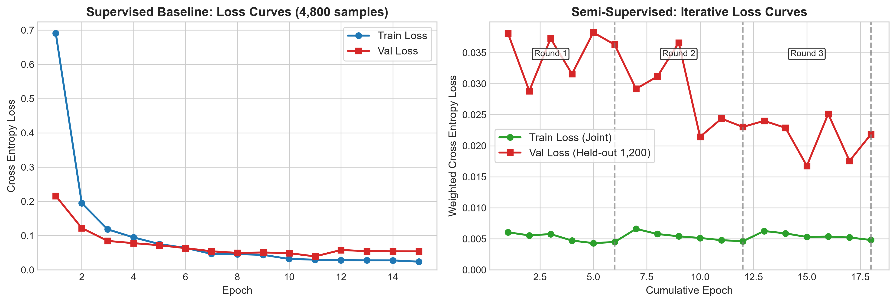

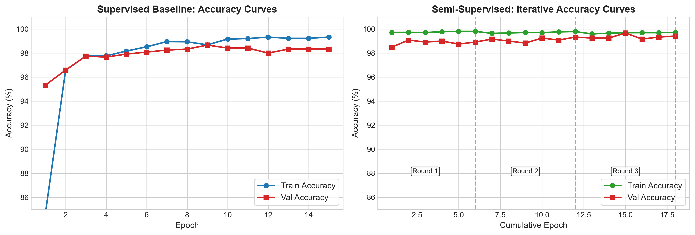

### 8.4 Matriks Konfusi dan Metrik Per Kelas

Berikut adalah perbandingan matriks konfusi antara Supervised Baseline dan Semi-Supervised Model pada 10.000 data uji:

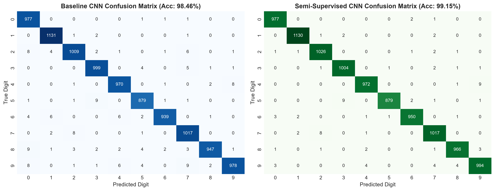

Tabel metrik presisi, recall, dan F1-Score per kelas (digit 0 hingga 9) menunjukkan peningkatan konsisten di seluruh kelas digit:

| Digit | Baseline Precision | Baseline Recall | Baseline F1 | SSL Precision | SSL Recall | SSL F1 | Perubahan F1 |
|:---:|:---:|:---:|:---:|:---:|:---:|:---:|:---:|
| **0** | 97,02% | 99,69% | 98,34% | 99,39% | 99,49% | **99,44%** | **+1,10%** |
| **1** | 98,86% | 99,65% | 99,25% | 99,39% | 99,74% | **99,56%** | **+0,31%** |
| **2** | 98,54% | 97,77% | 98,15% | 99,22% | 99,13% | **99,18%** | **+1,03%** |
| **3** | 98,42% | 98,91% | 98,67% | 98,82% | 99,50% | **99,16%** | **+0,49%** |
| **4** | 98,48% | 98,78% | 98,63% | 99,28% | 98,88% | **99,08%** | **+0,45%** |
| **5** | 98,21% | 98,54% | 98,38% | 99,10% | 99,22% | **99,15%** | **+0,77%** |
| **6** | 99,37% | 98,02% | 98,69% | 99,37% | 99,27% | **99,32%** | **+0,63%** |
| **7** | 97,51% | 98,93% | 98,21% | 98,83% | 98,83% | **98,83%** | **+0,62%** |
| **8** | 99,37% | 97,23% | 98,29% | 98,78% | 99,59% | **99,18%** | **+0,89%** |
| **9** | 98,89% | 96,93% | 97,90% | 98,40% | 98,71% | **98,56%** | **+0,66%** |
| **Macro** | **98,47%** | **98,44%** | **98,45%** | **99,16%** | **99,14%** | **99,15%** | **+0,70%** |

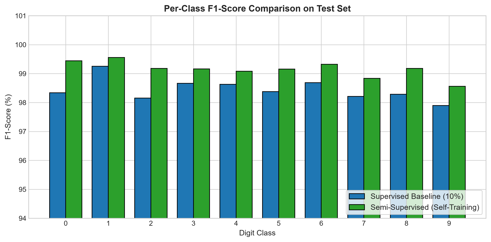

### 8.5 Analisis Kualitatif Kesalahan Prediksi Uji (Error Analysis)

Dari 10.000 citra uji resmi, model semi-terawasi akhir hanya melakukan 85 kesalahan klasifikasi (tingkat eror 0,85%). Gambar di bawah ini mengilustrasikan sampel representatif kesalahan tersebut beserta label kebenaran, label prediksi model, dan skor keyakinan:

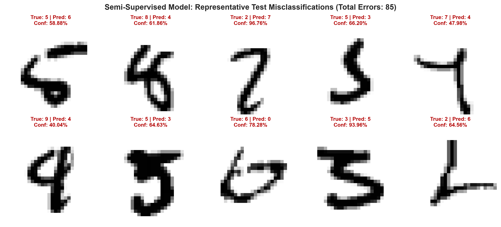

Inspeksi visual terhadap kasus kesalahan mengungkapkan beberapa pola sistematis:
- **Ambiguitas Bentuk Alami:** Beberapa sampel tulisan tangan memang sangat mirip dengan digit lain, misalnya digit 9 dengan loop atas tertutup rapat yang menyerupai digit 4, atau digit 2 dengan ekor tegak lurus yang menyerupai digit 7.
- **Ketidaksempurnaan Goresan Tinta:** Digit 5 yang putus pada lengkungan bawah terprediksi sebagai 3.
- **Ketidakpastian Model:** Pada sebagian eror, skor keyakinan model berada di kisaran 45% - 65%, mencerminkan bahwa distribusi probabilitas terbagi di antara dua hipotesis digit yang masuk akal.

---

## 9. Pembahasan

### 9.1 Efektivitas Pseudo-Labeling dan Rasio Manfaat Data Tak Berlabel
Eksperimen membuktikan bahwa pseudo-labeling berbasis keyakinan memberikan penguatan performa yang nyata pada pengenalan digit tulisan tangan. Dengan modal awal 4.800 sampel berlabel, model berhasil mengekstraksi informasi struktural dari 52.908 citra tanpa label. Peningkatan akurasi dari 98,46% ke 99,15% merupakan pencapaian signifikan pada dataset benchmark seperti MNIST, di mana rentang eror di atas 98% didominasi oleh kasus-kasus ambigus yang sulit.

### 9.2 Mitigasi Confirmation Bias melalui Thresholding dan Loss Weighting
Keberhasilan pipeline ini bertumpu pada dua instrumen utama:
1. **Ambang Batas $\tau = 0,95$**: Pada putaran pertama, filter konservatif ini menghasilkan akurasi pseudo-label luar biasa tinggi (**99,74%** terhadap *hidden ground truth*). Hanya 134 sampel dari 50.880 sampel yang salah terlabeli. Filter ini secara efektif memblokir sampel-sampel borderline yang rawan memicu *confirmation bias*.
2. **Loss Weighting $\alpha = 0,40$**: Mengurangi kontribusi gradien sampel pseudo-label sebesar 60% dibandingkan data berlabel asli mencegah pergeseran drastis pada batas keputusan (*decision boundaries*), sehingga representasi internal jaringan tetap stabil.

### 9.3 Dinamika Penurunan Presisi pada Round Lanjutan
Meskipun akurasi validasi terus naik hingga Round 3 (99,67%), diagnostik *post-hoc* mencatat bahwa presisi pseudo-label baru mengalami penurunan bertahap:
- Round 1: 99,74% (dari 50.880 sampel baru)
- Round 2: 96,80% (dari 1.469 sampel baru)
- Round 3: 91,06% (dari 559 sampel baru)

Fenomena ini sangat wajar secara teoritis: sampel yang tersisa di putaran kedua dan ketiga adalah sampel yang paling ambigu dan sulit bagi model awal. Penurunan presisi hingga 91,06% pada Round 3 menandakan bahwa proses iterasi harus dihentikan setelah 3 putaran; melanjutkan ke putaran keempat berisiko menyerap sisa 1.092 sampel yang memiliki rasio eror tinggi dan dapat mendegradasi generalisasi model.

### 9.4 Fenomena Overconfidence pada Out-of-Distribution (OOD) Data
Pengujian empiris pada modul `src/test_inference.py` menunjukkan temuan penting: ketika model diuji dengan citra kosong (*all zeros*) atau *uniform random noise*, model menghasilkan probabilitas softmax yang sangat tinggi (>97%). Hal ini mengonfirmasi literatur pembelajaran mendalam modern (Guo et al., 2017): lapisan Batch Normalization dan fungsi aktivasi ReLU mengakumulasi bias konstan ketika tidak ada sinyal fitur, menghasilkan logit dominan pada kelas tertentu. Temuan ini menegaskan bahwa metode pseudo-labeling mengasumsikan data tak berlabel berasal dari domain distribusi yang sama (*in-distribution*), dan tidak dapat secara otomatis menyaring data out-of-distribution murni tanpa teknik deteksi OOD tambahan.

---

## 10. Kesimpulan

Berdasarkan seluruh hasil eksperimen yang terukur dan dapat direproduksi:
1. **Pseudo-Labeling terbukti efektif** meningkatkan kemampuan klasifikasi CNN pada citra digit tulisan tangan MNIST di bawah anggaran label terbatas (10% labeled pool).
2. Model semi-terawasi berhasil meningkatkan akurasi dari **98,46%** menjadi **99,15%** pada 10.000 citra uji resmi, memangkas **44,81% kesalahan klasifikasi**, dan meningkatkan skor F1 di seluruh kelas digit (0-9).
3. Ambang batas keyakinan $\tau = 0,95$ dan pembobotan loss $\alpha = 0,40$ terbukti berhasil menekan *confirmation bias*, menjaga akurasi pseudo-label rata-rata sebesar **99,58%** dari total 52.908 citra yang diserap.
4. Performa model semi-terawasi (99,15%) mendekati performa model supervisi 100% label (99,29%) dengan selisih marjinal hanya 0,14%, mendemonstrasikan efisiensi anotasi yang luar biasa tinggi.

---

## 11. Keterbatasan dan Pengembangan

### 11.1 Keterbatasan
- **Sifat Dataset MNIST:** Citra MNIST telah terpusat rapi (*centered*) dan dinormalisasi ukurannya. Efektivitas pseudo-labeling pada dataset digit yang lebih heterogen dan berderau (seperti SVHN atau citra dokumen dunia nyata) memerlukan augmentasi data yang lebih ekstensif.
- **Skenario Label-Hiding Sintetis:** Eksperimen menyembunyikan label dari dataset latih resmi yang bersih; dalam industri nyata, data tak berlabel mungkin memiliki pergeseran distribusi (*covariate shift*) atau memuat kelas di luar 10 digit target.
- **Sensitivitas Ambang Batas:** Ambang batas statis $\tau = 0,95$ diterapkan seragam ke seluruh kelas. Beberapa digit yang secara inheren lebih bervariasi mungkin memerlukan ambang batas dinamis per kelas (*curriculum pseudo-labeling*).

### 11.2 Rekomendasi Pengembangan Masa Depan
1. **Curriculum Pseudo-Labeling (misal FlexMatch):** Menerapkan ambang batas dinamis yang disesuaikan dengan tingkat kesulitan masing-masing kelas.
2. **Konsistensi Regularisasi (Consistency Regularization):** Menggabungkan pseudo-labeling dengan augmentasi ganda (lemah vs kuat) seperti pada framework FixMatch.
3. **Kalibrasi Probabilitas (Temperature Scaling & Energy OOD Detection):** Menerapkan penskalaan temperatur untuk meredam *overconfidence* pada citra masukan yang ambigu atau di luar distribusi.

---

## 12. Cara Menjalankan Project

### 12.1 Penyiapan Lingkungan
Pastikan Python 3.9+ telah terpasang, lalu instal paket dependensi:
```bash
pip install -r requirements.txt
```

### 12.2 Eksekusi Pipeline Lengkap
Jalankan modul secara berurutan:
```bash
# 1. Validasi integritas dataset IDX
python src/data_loader.py

# 2. Latih Supervised Baseline & Benchmark
python src/train_supervised.py

# 3. Jalankan Semi-Supervised Self-Training
python src/self_training.py

# 4. Evaluasi komparatif pada 10.000 citra uji
python src/evaluate.py

# 5. Bangun 12 grafik publikasi
python src/visualize.py

# 6. Uji inferensi dan kasus batas (blank/noise/hybrid)
python src/test_inference.py
```

### 12.3 Menjalankan Aplikasi Interaktif Streamlit
```bash
streamlit run app.py
```
Buka peramban di `http://localhost:8501`.

---

## 13. Dokumentasi Aplikasi Interaktif & Tangkapan Layar Lengkap

Aplikasi interaktif berhasil dibangun menggunakan **Streamlit** (`app.py`) dengan arsitektur multi-halaman berbasis hierarki navigasi sidebar. Seluruh 4 halaman/modul aplikasi telah diverifikasi dan didokumentasikan melalui tangkapan layar penuh (*full-page screenshot*) beresolusi tinggi tanpa pemotongan elemen:

1. **Halaman 1: Live Digit Inference & Uncertainty**
   - Menampilkan uji coba inferensi langsung, pemilihan digit representatif MNIST, visualisasi matriks input $28 \times 28$, kartu prediksi digit, skor keyakinan, serta diagram distribusi probabilitas 10 kelas.
   - Lokasi Berkas: `streamlit/01_live_digit_inference.png`
   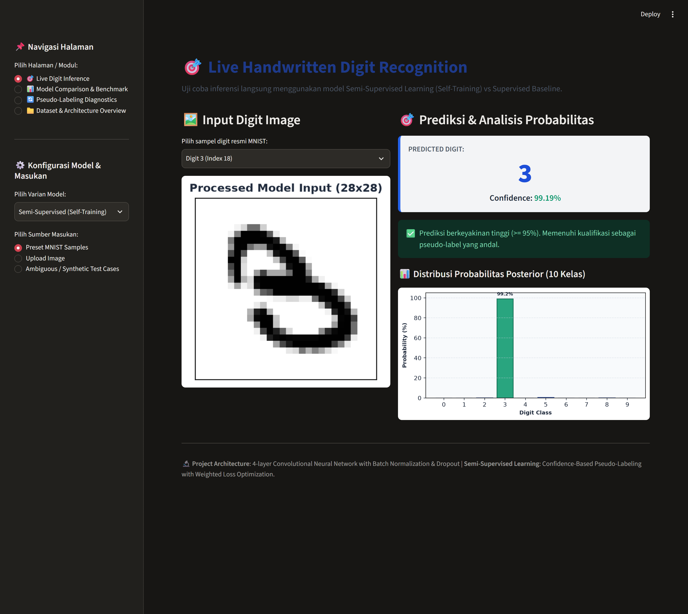

2. **Halaman 2: Model Benchmark & Evaluation Metrics**
   - Menampilkan metrik KPI utama (Baseline 98,46%, Semi-Supervised 99,15%, Upper-bound 99,29%, Reduksi Eror 44,81%), grafik komparasi akurasi uji resmi, perbandingan F1-score seluruh kelas, matriks konfusi, dan analisis kasus kesalahan uji.
   - Lokasi Berkas: `streamlit/02_model_benchmark_metrics.png`
   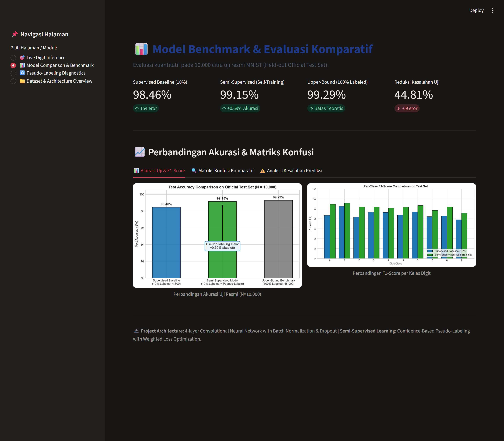

3. **Halaman 3: Pseudo-Labeling & Self-Training Diagnostics**
   - Mendokumentasikan dinamika iterasi semi-terawasi: ambang batas $\tau = 0,95$, bobot penalti $\alpha = 0,40$, statistik penyerapan 52.908 citra per putaran, akurasi *post-hoc*, distribusi kelas pseudo-label, kurva densitas keyakinan, dan konvergensi akurasi multi-round.
   - Lokasi Berkas: `streamlit/03_pseudolabel_diagnostics.png`
   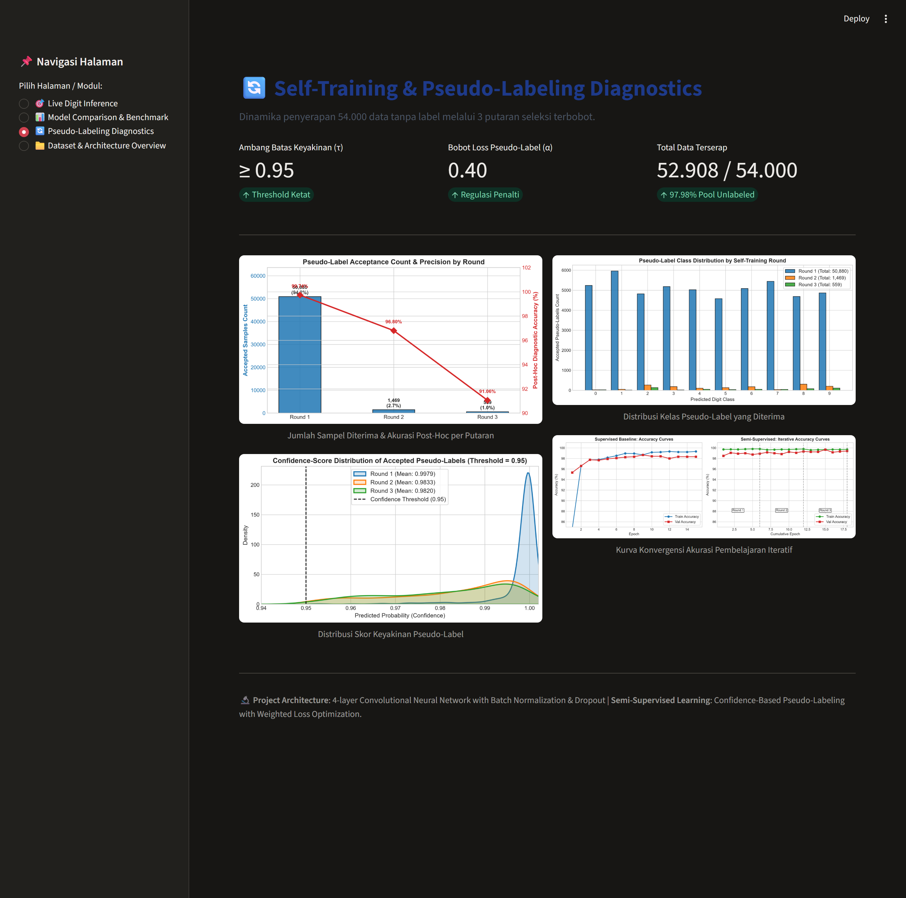

4. **Halaman 4: Dataset & CNN Architecture Overview**
   - Menyajikan inspeksi visual dataset MNIST, grid sampel 0-9, grafik distribusi kelas 60.000 citra latih, diagram pemisahan terstratifikasi (10% Labeled vs 90% Unlabeled), serta kurva loss pelatihan.
   - Lokasi Berkas: `streamlit/04_dataset_architecture_overview.png`
   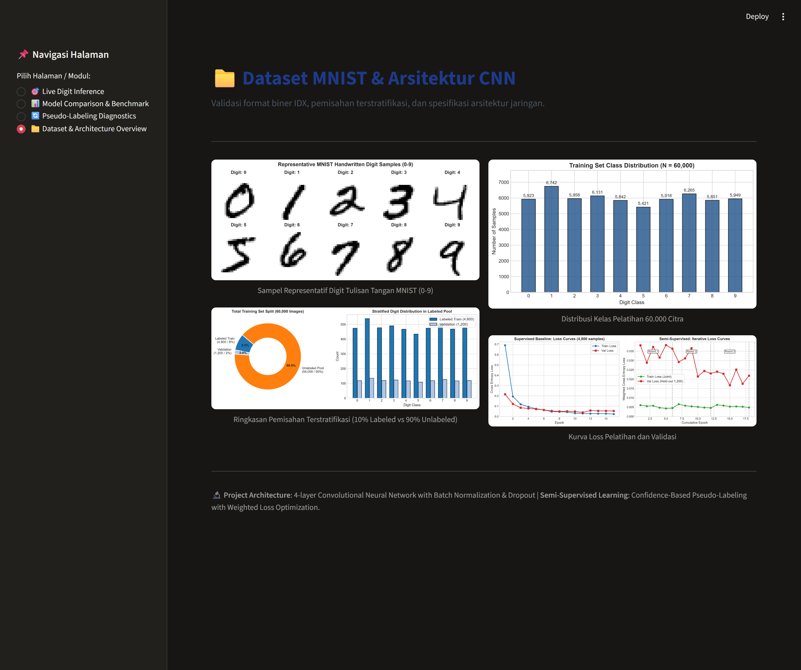

Daftar inventaris tangkapan layar dan metadata resolusi terdokumentasi lengkap pada file indeks:  
`streamlit/SCREENSHOT-INDEX.md`

---

## 14. Daftar Artefak Proyek

| Kategori | Lokasi File | Deskripsi |
|---|---|---|
| **Spesifikasi & Panduan** | `TASK.md` | Dokumen spesifikasi dan acceptance criteria |
| | `README.md` | Panduan ringkas penggunaan dan instruksi instalasi |
| | `requirements.txt` | Daftar pustaka Python yang digunakan |
| | `final_report.md` | Laporan komprehensif hasil eksperimen (dokumen ini) |
| **Kode Sumber** | `src/data_loader.py` | Modul pembaca biner dan validator IDX |
| | `src/data_split.py` | Modul pemisahan data terstratifikasi & isolasi label |
| | `src/model.py` | Definisi arsitektur CNN 4 lapis (DigitCNN) |
| | `src/train_supervised.py` | Pelatih supervised baseline & benchmark |
| | `src/self_training.py` | Pipeline iterative pseudo-labeling |
| | `src/evaluate.py` | Modul evaluasi metrik pada official test set |
| | `src/visualize.py` | Generator 12 visualisasi wajib publikasi |
| | `src/test_inference.py` | Script pengujian diagnostik inferensi model |
| | `app.py` | Aplikasi antarmuka interaktif Streamlit |
| **Model Checkpoints** | `outputs/models/baseline_model.pt` | Bobot terbaik supervised baseline (Val Acc 98,67%) |
| | `outputs/models/semisupervised_model.pt`| Bobot terbaik semi-supervised model (Val Acc 99,67%) |
| | `outputs/models/upper_bound_model.pt` | Bobot benchmark supervisi penuh (Val Acc 99,39%) |
| **Metrik Evaluasi** | `outputs/metrics/baseline_history.json` | Riwayat epoch loss/akurasi baseline |
| | `outputs/metrics/self_training_history.json`| Riwayat detail putaran pseudo-labeling |
| | `outputs/metrics/evaluation_metrics.json` | Metrik evaluasi lengkap test set resmi |
| **Visualisasi** | `figures/01_mnist_samples_grid.png` | Grid sampel digit MNIST 0-9 |
| | `figures/02_train_class_distribution.png`| Distribusi kelas dataset latih 60.000 |
| | `figures/03_data_split_summary.png`| Diagram pemisahan data berlabel vs tak berlabel |
| | `figures/04_training_val_loss_curves.png` | Kurva loss pelatihan dan validasi |
| | `figures/05_training_val_accuracy_curves.png` | Kurva akurasi pelatihan dan validasi |
| | `figures/06_pseudolabel_acceptance_by_round.png`| Jumlah penerimaan pseudo-label per putaran |
| | `figures/07_pseudolabel_class_distribution.png` | Distribusi kelas pseudo-label per putaran |
| | `figures/08_confidence_distribution.png`| Distribusi skor keyakinan pseudo-label |
| | `figures/09_test_accuracy_comparison.png`| Perbandingan akurasi uji ketiga model |
| | `figures/10_confusion_matrices.png`| Matriks konfusi baseline vs semi-supervised |
| | `figures/11_per_class_f1_comparison.png`| Perbandingan F1-score seluruh kelas digit |
| | `figures/12_test_error_analysis.png` | Analisis visual sampel kesalahan uji |
| **Tangkapan Layar** | `streamlit/01_live_digit_inference.png` | Halaman 1: Live Digit Inference & Uncertainty |
| | `streamlit/02_model_benchmark_metrics.png` | Halaman 2: Model Benchmark & Evaluation Metrics |
| | `streamlit/03_pseudolabel_diagnostics.png` | Halaman 3: Pseudo-Labeling Diagnostics |
| | `streamlit/04_dataset_architecture_overview.png` | Halaman 4: Dataset & Architecture Overview |
| | `streamlit/streamlit_app_fullpage.png`| Screenshot penuh aplikasi interaktif (Halaman 1) |
| | `streamlit/SCREENSHOT-INDEX.md` | Indeks tangkapan layar otomatis CDP |
